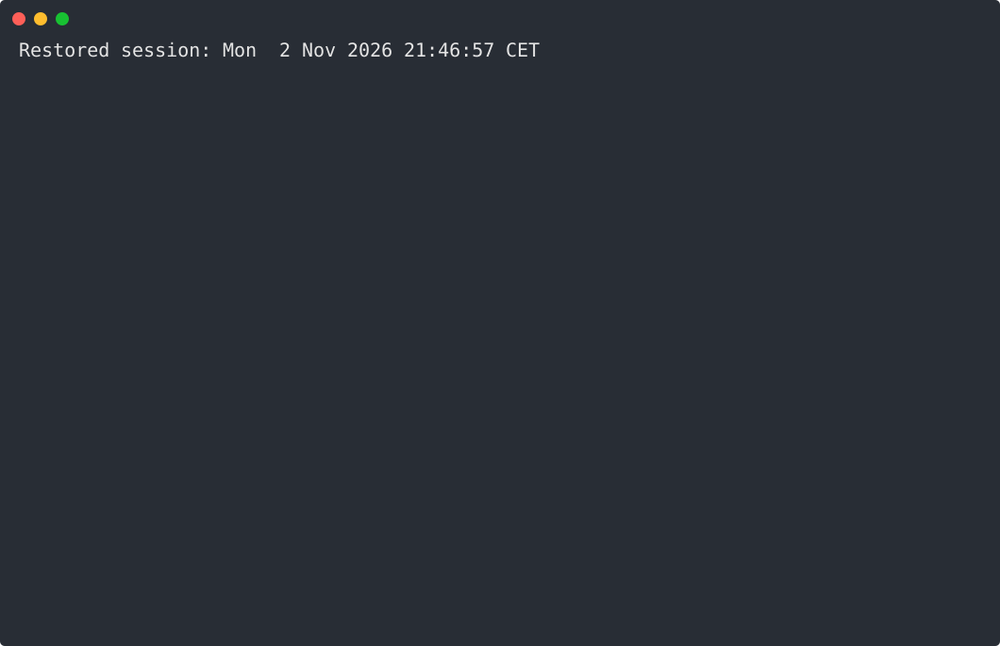

<h1 align="center">
    klar.
</h1>
<p align="center">
    structured json → clear output
</p>
<p align="center">
    
</p>

## Usage

```shell
    <some command> | klar
    <some command> | klar --level warn --time absolute
```

## Install

```shell
    go install github.com/tyhal/klar/cmd/klar@latest
```

```shell
    brew install tyhal/tap/klar
```
